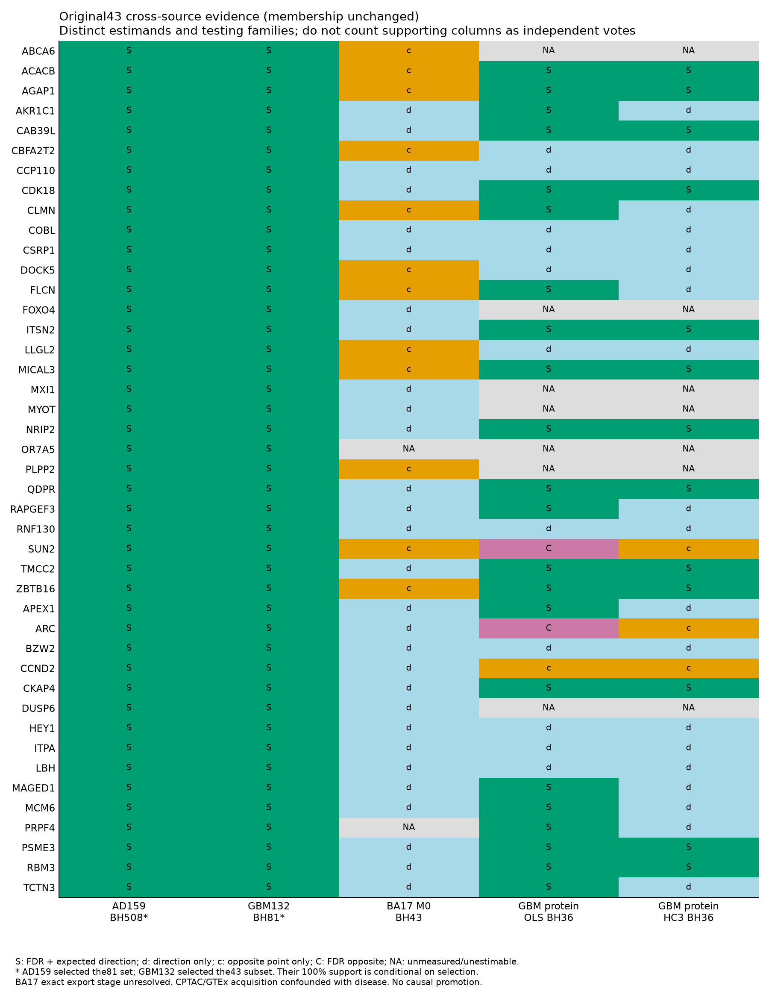

# MRQI — Alzheimer’s disease / glioma evidence atlas

**RP2.4.1 · exploratory research · snapshot: 2026-10-16 · manuscript author review pending**

本仓库公开 AD（阿尔兹海默症）与胶质瘤／历史 GBM 反向表达研究的**可审计实现、完整基因级汇总结果和研究边界**。它是本地 MRQI 项目的筛选公开镜像，不是原始数据仓库，也不表示整套 RP2.4.1 已完成。

**目前可支持的结论：来源、脑区及肿瘤–宿主区室限定的探索性反向表达程序，伴随明显患者异质性和尺度依赖。** 目前不能据此确立 AD–GBM 临床保护效应、同细胞拮抗、现代 IDH-wildtype GBM 对健康人群的独立确认，或因果治疗靶点。

## 从哪里开始

- [完整 81 基因对账表](results/S14a_All81_Aligned_Complete_Evidence_2026-10-16.tsv) 与 [原 43 基因对账表](results/S14b_Original43_Aligned_Complete_Evidence_2026-10-16.tsv)：各 163 列，支持、冲突、方向一致但未显著、缺失和不可检验均保留。
- [研究现状与下一阶段](docs/EVIDENCE_AND_NEXT_STEPS.md)：可以说什么、不能说什么，以及哪些工作尚未执行。
- [Methods / Results / 图例工作稿](docs/METHODS_RESULTS_WORKING_DRAFT.md)：14 节 Methods、8 节 Results、9 条图例；不是最终批准稿。
- [来源与对照职责](docs/DATA_SOURCES.md)、[124 行来源／模型登记](results/S13_Source_Model_Family_Alignment_Registry_2026-10-16.tsv)、[复现说明](docs/REPRODUCIBILITY.md)。124 行是上下文，不是 124 个独立队列。
- [公开范围](docs/PUBLICATION_SCOPE.md)、[历史工作与复用价值](docs/HISTORY_AND_REUSE.md)、[资产来源哈希](docs/PUBLIC_ASSET_PROVENANCE.tsv)。

## 研究问题和估计对象

疾病遗传易感性的 MR 问题与组织表达问题分别解释。AD−对照、同一患者肿瘤核心−邻近宿主组织、肿瘤内部细胞状态、蛋白组差异和空间描述具有不同估计对象；它们不能合并成同一个风险比，也不能互相充当因果证明。

发现分析使用共同的 16,068 个基因，构建 32,136 个预定义方向性 IUT 假设：R1 为 AD 上调且肿瘤–宿主下调；R2 相反。IUT 取两侧**单侧**P的最大值，BH/BY 保留完整 2G 家族。随后 508 → 81 → 43 是候选形成链；形成来源上的 81/81 或 43/43 不是新的无偏复制成功率。81／43 身份及方向不依后续结果重排。

## 已完成的主要结果

| 证据层 | 主要结果 | 解释限制 |
| --- | --- | --- |
| Bulk 发现 | GSE125583：218 AD / 70 对照；GSE165595：15 患者 / 30 库。共同 16,068 基因；32,136 方向检验中 BH 508、BY 130 | AD 个体 RIN/PMI/batch 不全；肿瘤来源含 11 历史4级与4例3级；宿主不等于健康人群 |
| AD 候选形成 | GSE159699：12 AD / 10 Old；原508家族中81支持 | 8 Young 另列；81在此来源形成 |
| 限定肿瘤候选形成 | GSE13276：5 成人历史GBM患者、12数组；81中43支持、16仅方向、1点相反、21身份缺失 | 配对邻近白质；不是现代GBM健康人群复制；43在此形成 |
| BA17 表达验证 | 原43中41可测：29方向一致、12点相反、2缺失，**主模型FDR支持0** | 38 AD / 8 对照主模型；发布尺度导出尚未完全闭合；FOXO4仅敏感性尺度显著 |
| AD 单核 | 11 AD / 7 对照，六谱系供者伪bulk；12个BH基因–谱系命中、9基因；BY0，RIN敏感性单基因BH0 | 不把细胞当独立病例；部分模型供者不足；程序尺度为队列／谱系内Z分数 |
| 肿瘤状态 | 两来源41可比基因中39均值峰一致；原43仅17在两来源全部共同患者均一致 | GSE211376仅自身11患者；GSE182109主14患者；tumour-only定位不是病例对照复制 |
| 既有公开蛋白 | PSME3 / CKAP4 / NRIP2有双来源OLS方向支持；**共同预期反向方向的HC3支持0** | AD可估24／GBM36为原主BH分母；CPTAC疾病与采集来源混杂；ARC/SUN2等冲突保留 |
| 空间 | 13标本／5患者，三对区域有效患者2／4／3；完整43均可覆盖 | 描述性、无新P/FDR；患者混合方向明显；RNA派生标签不是独立病理真值 |

这里的“支持”必须结合原检验族和模型读取，不能将所有方向一致都当作显著。不同平台的β不可直接相加、排行或合成临床评分。



## 仓库内容

```text
code/implementation/  实际统计与对账实现快照；保留历史配置
results/              完整基因级汇总、敏感性、家族与缺失状态
figures/              9幅原项目汇总图
docs/                 方法结果工作稿、来源、历史、边界和下一阶段
tools/                无外部依赖的公开包校验程序
PUBLIC_MANIFEST.tsv   每个发布文件的bytes与SHA-256
```

本地24表／121,573记录的完整工作集仍保留在canonical项目中。公开镜像主动不包含供者／患者级行、逐人删除表、raw表达、FASTQ、临床病例、受控文件、身份／签署申请、第三方文献PDF和完整本地日志；S08c/S10a移除了`patient_ids`列。这不改变本地全表或研究结果，公开派生表的变换和两端哈希见来源登记。

## 如何核验

安装Python 3（校验程序仅用标准库），从仓库根目录运行：

```bash
python tools/verify_public_release.py
```

它核查全部公开资产的bytes/SHA、完整81／43身份与子集、163列、32,136假设及508候选等结构。**此命令不从raw数据重跑研究，也不等于生物学结果独立复制。** 原模型重建需要按[复现文档](docs/REPRODUCIBILITY.md)取得各来源数据、重建目录及历史依赖；部分历史Python精确环境仍不完整，实施快照不是一键端到端pipeline。

## 当前堵点与下一阶段

1. 研究者尚需完成整合稿件的真实主张／范围审阅；机器验收不能代替作者批准。
2. 优先寻找具有新信息、供者独立且对照病因可解释的GBM来源；现代IDH-wildtype优先，历史定义单列。不能用便利的TCGA–GTEx拼接假装消除来源混杂。
3. 独立AD蛋白受控来源的正式签署、提交／批准及来源准入尚未完成；既有公开AD蛋白不等于这项独立复制。
4. BA17尺度、空间RNA标签循环性和跨来源患者桥接继续限定解释。
5. 新81／43靶点遗传与真实功能实验尚未执行；旧310基因阴性不逐基因投射到新集合，也不自动封锁合格的新模态研究。

下一阶段为 **EDA8：独立验证准入与限定主张审阅**。新来源须先冻结来源、独立单位、模型、完整81／43和校正家族，再开展分析；不通过反复挑来源、挑敏感性最小P或删除冲突来“救题”。

## 来源、引用与状态

数据应从[原始研究和官方入口](docs/DATA_SOURCES.md)取得，并分别引用原论文。项目尚未提供正式发表论文或DOI；引用仓库时请记录仓库URL、commit及快照日期，不把工作稿当已发表研究。GitHub公开不改变第三方原始数据的许可／访问条件；原代码尚未另行授予开源许可证，详见[权利说明](RIGHTS_AND_THIRD_PARTY_DATA.md)。

AI用于公开文献、代码辅助、整理和核验；没有将受控病例或受限制衍生内容作为本仓库发布资产。本轮审计／建库不新增生物学拟合或P/q。对外材料不含机构安全认证、真实签名或数据访问获批的替代证明。

### English summary

This is a curated public research mirror for exploratory Alzheimer’s disease–glioma reciprocal expression analyses under RP2.4.1. It preserves the complete 81-gene and original 43-gene evidence matrices, negative findings, conflicts, missingness and original multiplicity families. Candidate formation is distinguished from independent replication. The evidence supports source-, region- and compartment-dependent expression patterns with patient heterogeneity. It does **not** establish clinical protection, same-cell antagonism, a modern population-normal GBM comparison or causal therapeutic targets. See the source register and methods working draft before interpreting any significance column. No raw, participant-level or controlled data are distributed.
