# EDA88 图例披露补充

原图像、效应、P／q及家族均不改。MR结果属于独立的已归档遗传背景，不映射为81／43靶点证据。57幅全部有披露决定；43幅汇总图随候选包，14幅个体／Run／临床关联图仅本地。完整图例保留对未随包图的索引，不表示像素已公开。S1旧图中的DeepConsensus申请状态是历史状态，不是来源准入或已完成数据；M4A、S36、S45留一范围不是置信区间；S3空间仅描述。

# 主图图例与交付对应

当前交付对应EDA84主文和EDA83读者包。完整81／43、原检验家族及所有阴性、冲突、缺失保留；17／17为13数值／描述、1原始计数处理、1作者汇总提取和2技术审计，不是17次独立生物学复制。R08历史142／142与当前110／142及32项差异分列；R12不是作者实际MS-DAP模型复现，R11从冻结标签起步。原图件未改，文件验收不改变科学结果。

读者导航：[EDA84主文](CURRENT_MANUSCRIPT_WORKING_DRAFT.md)；[EDA83读者入口](../reproduction/All17_Route_Scope.tsv)。历史技术说明保留在EDA80，以下逐图保留科学说明并连接现行文件。

## 主图1 来源职责与顺序候选形成

**当前读者路线：** R01（仅本地或历史索引，见逐项披露清单）；R02（仅本地或历史索引，见逐项披露清单）；R03（仅本地或历史索引，见逐项披露清单）；R04（仅本地或历史索引，见逐项披露清单）；R05（仅本地或历史索引，见逐项披露清单）；R06（仅本地或历史索引，见逐项披露清单）；R10（仅本地或历史索引，见逐项披露清单）；R12（仅本地或历史索引，见逐项披露清单）

按原来源职责和既有计数重述发现与顺序选择，所有后续证据仍保留81／43完整身份。

**当前解释限制：** 流程为冻结既有结果的文字导航，不是新科学统计图；历史肿瘤不统一重命名为现代IDH-wildtype GBM。

**完整补表：** [S01](../supplements/S01_S01_Source_Roles_Selection_And_Multiplicity.tsv)，[S02a](../supplements/S02a_S02a_All16068_Discovery_Effects_And_Sensitivity.tsv)，[S02b](../supplements/S02b_S02b_All32136_Directional_IUT_Tests.tsv)，[S03a](../supplements/S03a_S03a_All508_AD_Validation_And_Discovery_Context.tsv)，S04a（S04a仅本地／索引；见[披露清单](All211_Actual_Payload_Index_And_Local_Disclosure.tsv)），S04b（S04b仅本地／索引；见[披露清单](All211_Actual_Payload_Index_And_Local_Disclosure.tsv)）

**正文定位：** CM1P;CM2P1;CM2P2;CR1P。原资产：NEW_NAVIGATION。

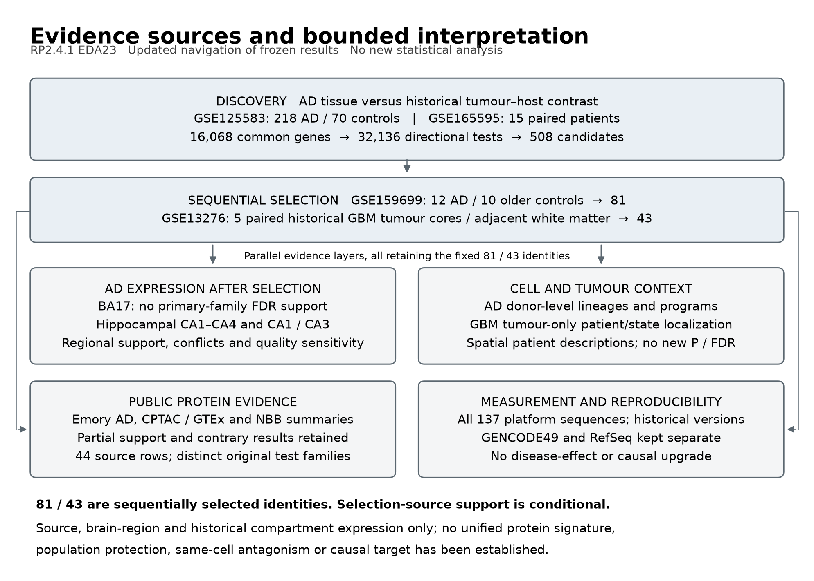

## 主图2 完整43跨来源方向与原检验家族

**当前读者路线：** R02（仅本地或历史索引，见逐项披露清单）；R03（仅本地或历史索引，见逐项披露清单）；R04（仅本地或历史索引，见逐项披露清单）；R05（仅本地或历史索引，见逐项披露清单）；R06（仅本地或历史索引，见逐项披露清单）；R07（仅本地或历史索引，见逐项披露清单）；R09（仅本地或历史索引，见逐项披露清单）；R10（仅本地或历史索引，见逐项披露清单）

原EDA5图按固定43身份显示AD159、GBM132、BA17 M0以及GBM公开蛋白OLS和HC3五列证据。颜色与符号按图内图例；原FDR方向支持S、仅方向一致d、显著相反C、相反点估计c与缺失NA分别解释。GSE159699与GSE13276属于候选形成来源；其全体支持不能解释为新复制成功率。各列检验家族及尺度不同，颜色不可相加为因果证据等级。既有公开AD蛋白另见补图S2；完整81背景见补图S5及表S04a。

**当前解释限制：** 选择来源的全体支持不是无偏复制率；本图只含所示历史五列，更新蛋白与海马见主图3和5。

**完整补表：** [S03a](../supplements/S03a_S03a_All508_AD_Validation_And_Discovery_Context.tsv)，S04b（S04b仅本地／索引；见[披露清单](All211_Actual_Payload_Index_And_Local_Disclosure.tsv)），S05（S05仅本地／索引；见[披露清单](All211_Actual_Payload_Index_And_Local_Disclosure.tsv)），[S06a](../supplements/S06a_S06a_BA17_All81_All7_Frozen_Models.tsv)，[S09](../supplements/S09_S09_Public_Protein_All81_All8_Source_Models.tsv)，S24b（S24b仅本地／索引；见[披露清单](All211_Actual_Payload_Index_And_Local_Disclosure.tsv)）

**正文定位：** CR1P;CR2P;CR4P1。原资产：F02。

## 主图3A BA17主模型与七模型方向

**当前读者路线：** R07（仅本地或历史索引，见逐项披露清单）

逐项展示GSE203206的M0及M1–M6原有结果。M0为限定发布尺度主模型；敏感性模型不是独立队列，也不替代M0。主模型38AD/8对照，41/43可测；OR7A5、PRPF4保留缺失位置。q43/q81使用原固定家族。FOXO4仅在相对尺度M6出现主家族FDR支持，应解释为尺度依赖。原主模型全部FDR阴性，逐供者删除另见表S06b。 各敏感性模型的实际N及协变量见S13，均未替代主模型。

**当前解释限制：** 主模型无原家族FDR支持；M6的FOXO4支持是尺度依赖，不能替换M0。

**完整补表：** [S06a](../supplements/S06a_S06a_BA17_All81_All7_Frozen_Models.tsv)，S06b（S06b仅本地／索引；见[披露清单](All211_Actual_Payload_Index_And_Local_Disclosure.tsv)），S13（S13仅本地／索引；见[披露清单](All211_Actual_Payload_Index_And_Local_Disclosure.tsv)），S24b（S24b仅本地／索引；见[披露清单](All211_Actual_Payload_Index_And_Local_Disclosure.tsv)）

**正文定位：** CR2P。原资产：F03。

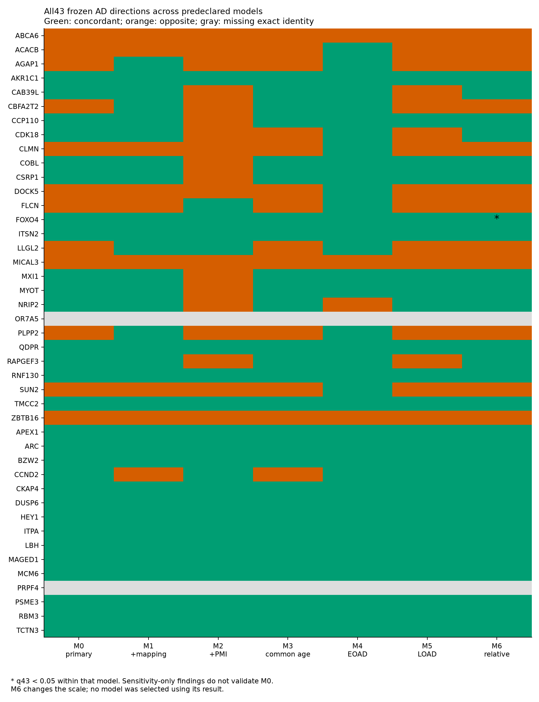

## 主图3B 完整43四脑区AD效应

**当前读者路线：** R14（仅本地或历史索引，见逐项披露清单）

F03：完整原43的四脑区AD−NC效应及原688家族，灰色缺测不当零；不能只展示有利脑区。

**当前解释限制：** 原688家族，CA1支持与其他区冲突同时保留；不能仅展示CA1或择最小q。

**完整补表：** [S20b](../supplements/S20b_Complete43_M0_All16Contrasts_2026-10-18.tsv)，[S20d](../supplements/S20d_Complete43_AllModels_All16Contrasts_2026-10-18.tsv)

**正文定位：** E20R01。原资产：F19。

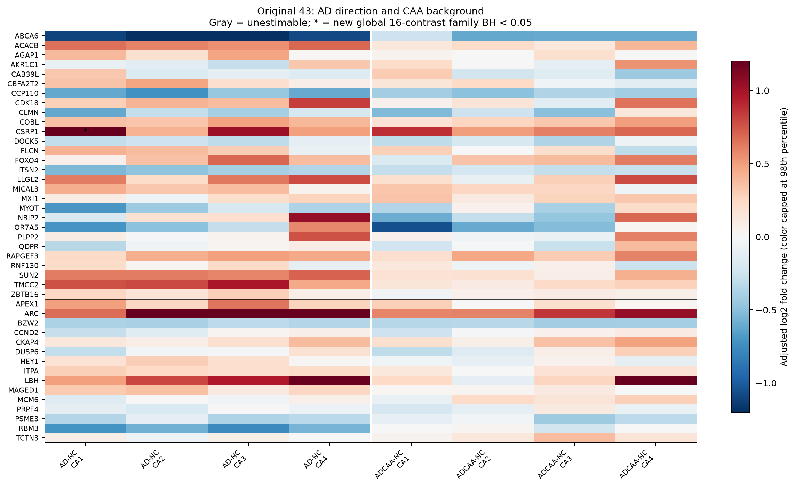

## 主图3C 完整43 CA1 CA3及配对差分

**当前读者路线：** R15（仅本地或历史索引，见逐项披露清单）

F03_Complete43与F03_Complete81：三上下文完整效应矩阵，黑横线分开旧R1 AD-up与R2 AD-down，颜色是新log2强度效应本身而非“支持”。星号仅为相应固定129/243族BH<.05，配对差分不强加旧AD方向。灰色代表原探针检测过滤或注释缺失，不能当零。

M0 CA1 n31(16AD/15Control)，CA3 n30(15/15)，配对差分29人(14/15)，模型调整年龄/性别/PMI/脑库/chip。Δ=CA3-CA1，AD系数是AD对该差分的影响；差分模型含chip虚拟变量差，不是简单比较两区P。所有源病例/对照均为来源定义的组织病理分组，Control可有低期Braak。

未声称研究整体保护、细胞内机制或因果靶点。CSRP1虽在CA1获候选族支持，去chip的FDR未保持；BZW2/PRPF4的原交互通过未在RIN相关完整子集/调整后维持。相应图必须与这些限制同读。

**当前解释限制：** 原129家族；配对差是CA3−CA1的AD效应，未通过不称CA1特异。

**完整补表：** [S21b](../supplements/S21b_Complete43_Primary_ThreeContexts_2026-10-18.tsv)，[S21d](../supplements/S21d_Complete43_AllModels_ThreeContexts_2026-10-18.tsv)

**正文定位：** E20R02。原资产：F29。

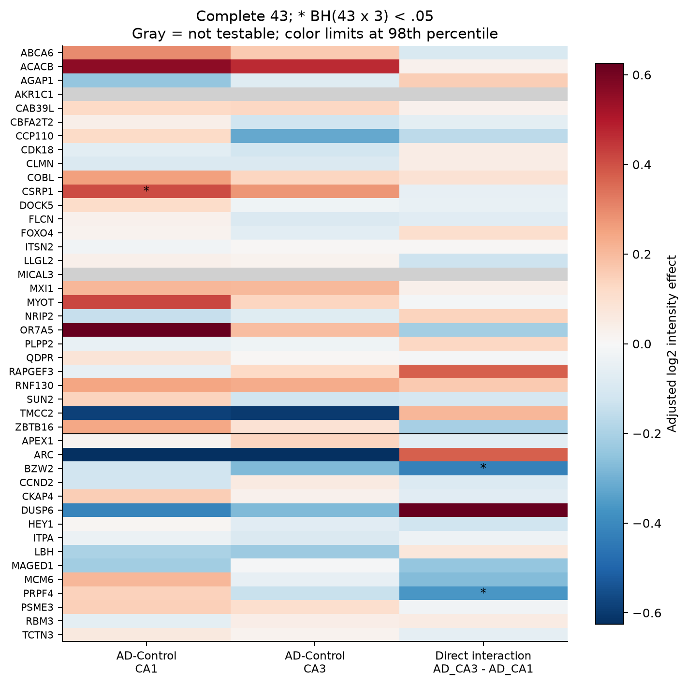

## 主图4A 完整43供者删除效应范围

**当前读者路线：** R16（仅本地或历史索引，见逐项披露清单）

完整原43，黑点是未删除的锚点效应，线段是所有有效逐供者删除后的最小至最大效应，均除以该锚点moderated SE。线段不是置信区间。不同来源/比较的标准化值不能作为生物效应大小的可比刻度；缺测行保留为空。

**当前解释限制：** 按锚点SE标准化的最小最大范围不是CI；不同平台不合并为同一生物效应。

**完整补表：** S22b（S22b仅本地／索引；见[披露清单](All211_Actual_Payload_Index_And_Local_Disclosure.tsv)），S22d（S22d仅本地／索引；见[披露清单](All211_Actual_Payload_Index_And_Local_Disclosure.tsv)）

**正文定位：** E20R03。原资产：F37。

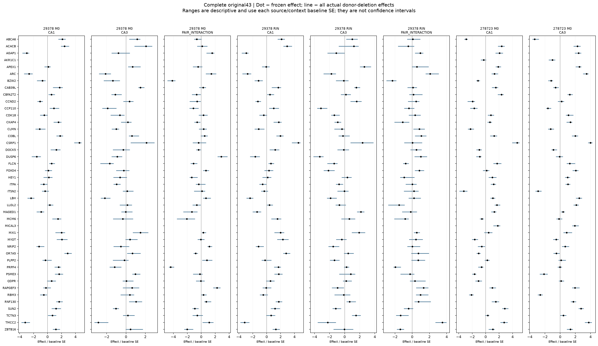

## 主图4B 芯片组成与条件信息

**当前读者路线：** R16（仅本地或历史索引，见逐项披露清单）

左二图为全部63公开数组的原始chip×诊断组成，非最终主模型样本数。右图为每个实际锚点设计中，调整chip后与不含chip时AD条件信息量之比；仅说明设计精度/共线性，不识别生物学或因果来源。CA3 chip6060仅AD。

**当前解释限制：** 左图63数组不是最终M0 N；信息量仅说明精度/共线性，不证明批次因果。

**完整补表：** S22a（S22a仅本地／索引；见[披露清单](All211_Actual_Payload_Index_And_Local_Disclosure.tsv)），S22c（S22c仅本地／索引；见[披露清单](All211_Actual_Payload_Index_And_Local_Disclosure.tsv)），S22e（S22e仅本地／索引；见[披露清单](All211_Actual_Payload_Index_And_Local_Disclosure.tsv)），S22g（S22g仅本地／索引；见[披露清单](All211_Actual_Payload_Index_And_Local_Disclosure.tsv)）

**正文定位：** E20R04。原资产：F39。

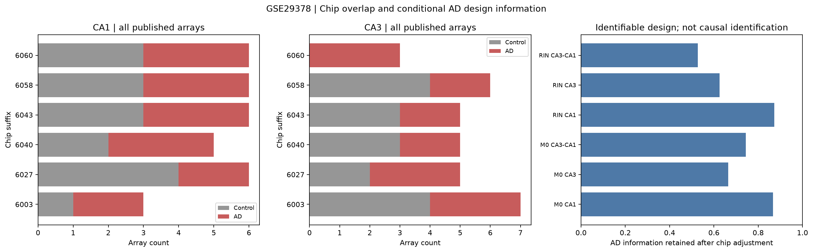

## 主图5A 完整43公开蛋白方向状态

**当前读者路线：** R09（仅本地或历史索引，见逐项披露清单）；R10（仅本地或历史索引，见逐项披露清单）；R12（仅本地或历史索引，见逐项披露清单）

完整43逐行展示既有Emory AD及CPTAC GBM的HC3稳健性状态与NBB两年龄层两方法。Emory／CPTAC原主分析仍为OLS，图中HC3各原实际BH分母24／36；标签不再写q43。NBB主MSqRob、敏感性DEqMS为作者比较／方法原q，不作新候选校正。期待方向按原RNA AD／GBM各自定义，未支持、反向、数值零、缺效应、单肽和多isoform分别标示。ARC全局2肽但每比较1肽，CSRP1多行未合并。图中颜色不能求和成因果等级，各来源尺度不平均（S14、S16）。 新序列审计见主图5B及补图S7、补图S6；每行生物学状态仍按原统计与身份规则，不按新肽数重新着色。

**当前解释限制：** HC3仅为既有蛋白稳健性；原分母24/36与NBB作者家族分开，ARC单肽、CSRP1多行不合并。

**完整补表：** [S09](../supplements/S09_S09_Public_Protein_All81_All8_Source_Models.tsv)，[S16b](../supplements/S16b_S16b_Original43_Author_Summary_TwoMethods_2026-10-17.tsv)，[S16c](../supplements/S16c_S16c_All44_TwoDiseaseContrasts_TwoMethods_2026-10-17.tsv)，S24b（S24b仅本地／索引；见[披露清单](All211_Actual_Payload_Index_And_Local_Disclosure.tsv)）

**正文定位：** CR4P1;CR5P1。原资产：F11。

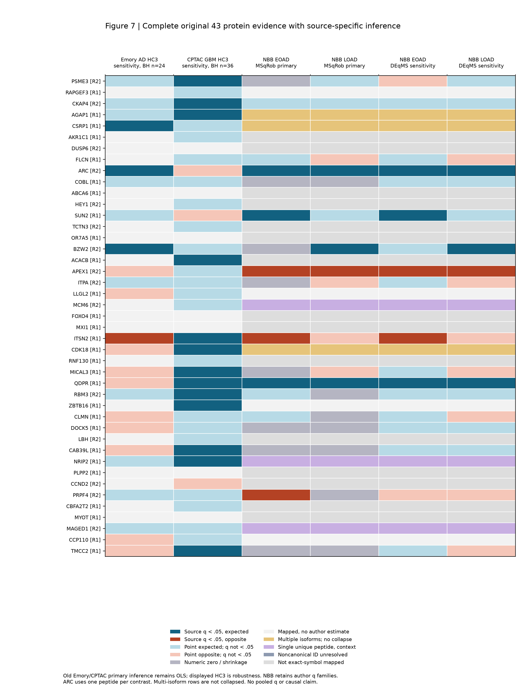

## 主图5B 全部44蛋白来源行的测量范围

**当前读者路线：** R13（仅本地或历史索引，见逐项披露清单）

全部44来源行按同一冻结顺序展示作者global unique及EOAD／LOAD used counts，并与完整processed的未修饰序列数、I/L gene-specific及entry-specific计数分栏。左侧数值属于作者S2统计流程，右侧是full-FASTA范围的技术描述；各辅助比较完整见S15b、S18c。空白表示未报告，非0。33/81与22/43旧gene资格、原beta/P/q不变，entry特异性不等于功能isoform。36行gene-specific≥2不等于36个确认基因。所有行实际MS-DAP筛选／fallback仍NOT_REPRODUCED（S15a、S18a）。

**当前解释限制：** 作者used肽与覆盖计数不同；36行多肽不是36个确认基因，实际MS-DAP模型未复现。

**完整补表：** S15a（S15a仅本地／索引；见[披露清单](All211_Actual_Payload_Index_And_Local_Disclosure.tsv)），[S15b](../supplements/S15b_S15b_All44_FourContrast_Reported_Peptide_Counts_2026-10-17.tsv)，[S18a](../supplements/S18a_S18a_All44_Full_Observed_Peptide_Technical_Audit.tsv)，[S18c](../supplements/S18c_S18c_All44_FourContrast_176Slots_Source_Count_Reconciliation.tsv)，S23g（S23g仅本地／索引；见[披露清单](All211_Actual_Payload_Index_And_Local_Disclosure.tsv)）

**正文定位：** CR6P1;D05。原资产：F12。

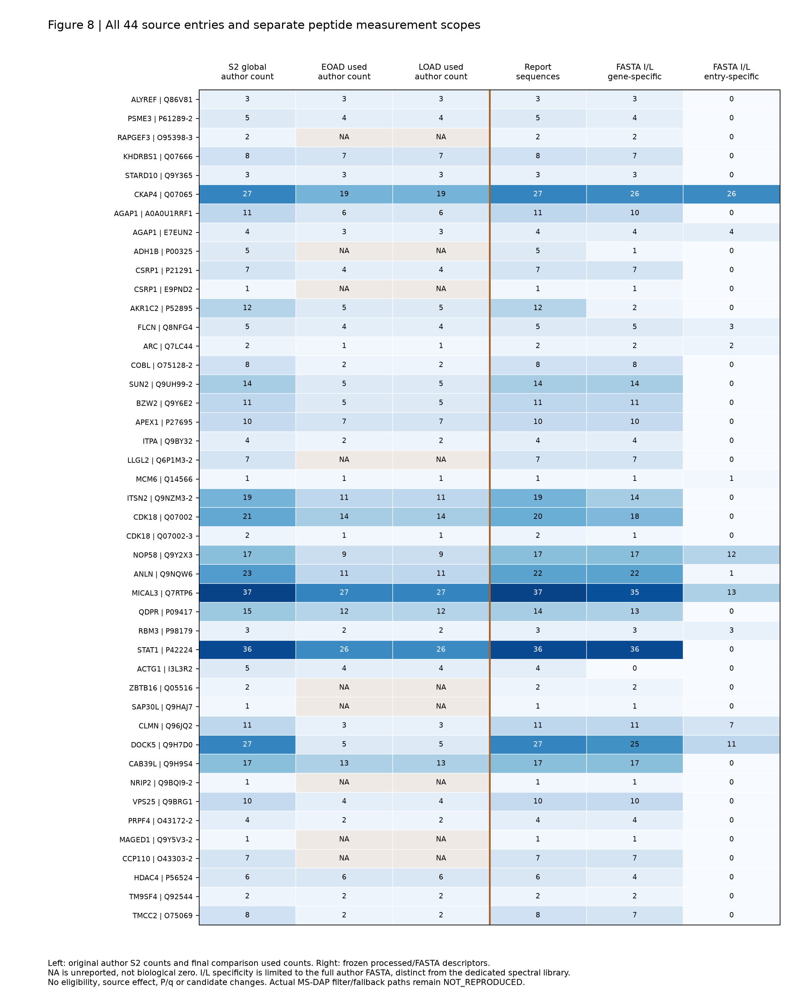

## 主图6A 完整43六谱系AD效应

**当前读者路线：** R08（仅本地或历史索引，见逐项披露清单）

保留全部43×6主候选位置、缺失与原有方向/FDR标记。原M0家族258项，背景家族486项；12个BH命中涉及9基因，BY及加入RIN后的单基因BH命中均为0。每谱系供者完整性不同，18名总供者不代表每个模型都具有18名可用供者。 EX的PMI敏感性未执行；条件性供者留一不重新估计完整源dispersion。

**当前解释限制：** 主258项的12个BH命中涉及9基因，BY及RIN后为0；PMI未执行与阴性分开。

**完整补表：** [S07a](../supplements/S07a_S07a_AD_All81_SixLineages_ThreeModels.tsv)，S07c（S07c仅本地／索引；见[披露清单](All211_Actual_Payload_Index_And_Local_Disclosure.tsv)），S24b（S24b仅本地／索引；见[披露清单](All211_Actual_Payload_Index_And_Local_Disclosure.tsv)）

**正文定位：** CR3P1。原资产：F08。

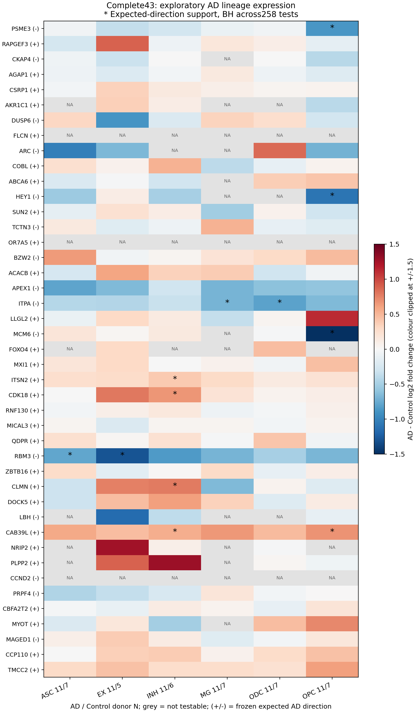

## 主图6B 肿瘤状态均值和患者一致性

**当前读者路线：** R08（仅本地或历史索引，见逐项披露清单）；R09（仅本地或历史索引，见逐项披露清单）；R11（仅本地或历史索引，见逐项披露清单）

完整43候选在GSE211376与GSE182109的三共同状态中比较；相应共同状态患者数为10及7。均值峰值为等患者汇总的描述性标签，患者一致性、逐患者删除稳定性和区域敏感性分别展示。39/41相同均值峰值与17/43全部患者一致具有不同分母与意义。来源均为肿瘤内状态定位；区域不视为独立患者，无新疾病P/FDR。

**当前解释限制：** 肿瘤内描述，不是GBM与正常细胞的疾病效应；39/41来源均值与17/43全部患者一致不能互换。

**完整补表：** S08a（S08a仅本地／索引；见[披露清单](All211_Actual_Payload_Index_And_Local_Disclosure.tsv)），[S08b](../supplements/S08b_S08b_GBM_All81_CNV_Mask_Context.tsv)，S08c（S08c仅本地／索引；见[披露清单](All211_Actual_Payload_Index_And_Local_Disclosure.tsv)），S08d（S08d仅本地／索引；见[披露清单](All211_Actual_Payload_Index_And_Local_Disclosure.tsv)）

**正文定位：** CR3P2;D02。原资产：F04。

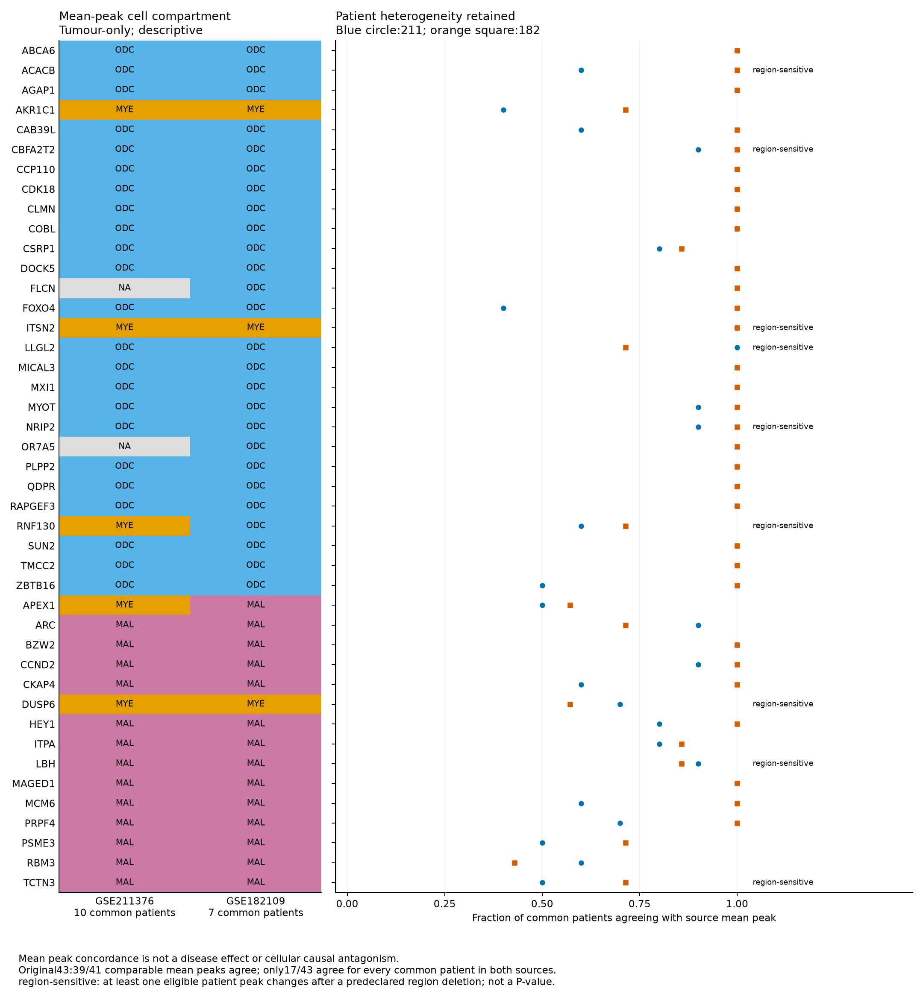

## 主图7 GENCODE49完整81探针归属

**当前读者路线：** R17（仅本地或历史索引，见逐项披露清单）

完整81，星号原43；数值为平台／合格／参考内归属／不同或未解析模型风险／无预期精确匹配／多转录本覆盖的探针数。状态色61绿、8混合风险、4技术不确定、8原不可测；原43为33／5／3／2。官方精确HGNC桥接合并同一生物基因的不同参考ENSG模型，原命中仍完整保留。这个33不等于蛋白完整81中33资格数，所有计数都不是新疾病复制。

**当前解释限制：** 61/8/4/8专属GENCODE49，不混成RefSeq的63/5/5/8；57交集不是新检验集。

**完整补表：** S23a（S23a仅本地／索引；见[披露清单](All211_Actual_Payload_Index_And_Local_Disclosure.tsv)），S23b（S23b仅本地／索引；见[披露清单](All211_Actual_Payload_Index_And_Local_Disclosure.tsv)），S23c（S23c仅本地／索引；见[披露清单](All211_Actual_Payload_Index_And_Local_Disclosure.tsv)），S23d（S23d仅本地／索引；见[披露清单](All211_Actual_Payload_Index_And_Local_Disclosure.tsv)），S23p（S23p仅本地／索引；见[披露清单](All211_Actual_Payload_Index_And_Local_Disclosure.tsv)），S23q（S23q仅本地／索引；见[披露清单](All211_Actual_Payload_Index_And_Local_Disclosure.tsv)）

**正文定位：** E20R05;E21R02。原资产：F41。

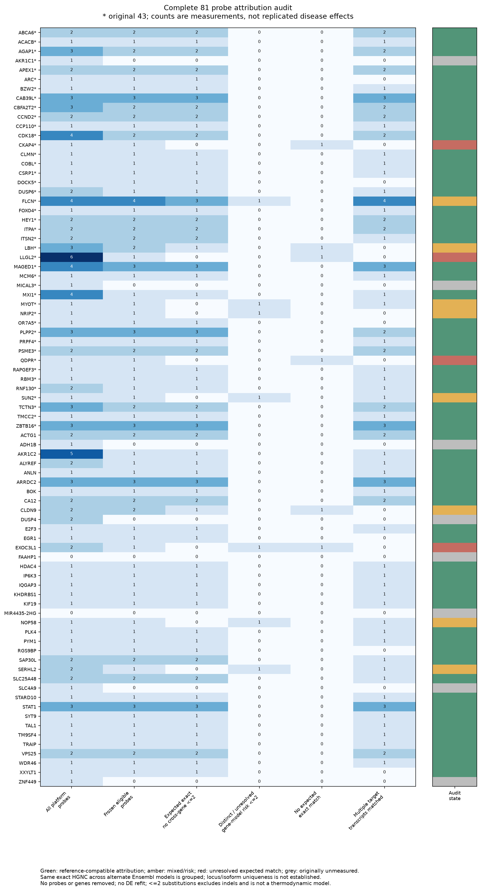
